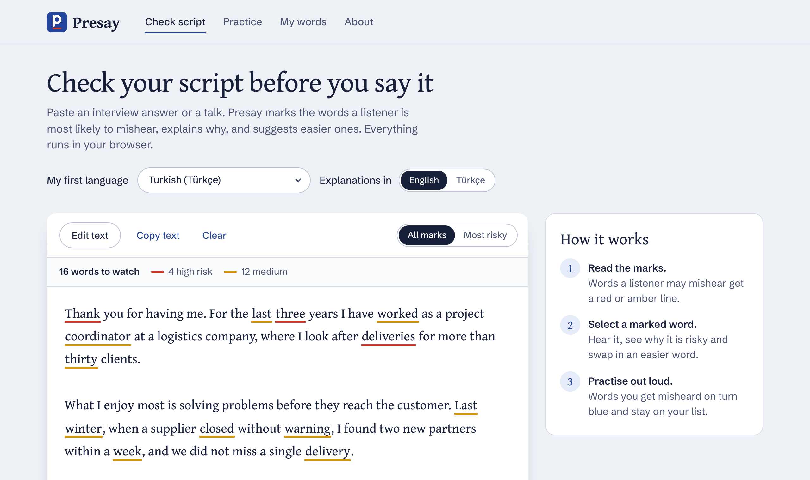

# Presay

Presay checks a script before you say it. Paste an interview answer or a talk
and it marks the words a listener is most likely to mishear, explains why (in
English or in your first language), suggests easier words, and lets you
practise out loud with your own script, 48 short texts from everyday situations
or rounds of single hard words. It is made for people who speak English as
another language.

**Try it at https://presay.app**

## How the project grew

It started as **Sayable**, an app that runs on your own computer. You read 30
short sentences aloud, it learned which sounds speech recognition missed when
you spoke, and it checked your scripts against that profile. It worked, but
trying it meant installing Python and downloading a 150 MB speech model first.

**Presay** is the second version, rebuilt as a website so that anyone can use
it with nothing to install. The speech model runs in the browser, there is no
server and no account, and instead of the 30-sentence setup it starts from
rules for ten first languages, then learns from your own practice.

| Folder | What it is | Built with |
| --- | --- | --- |
| [`web/`](web) | Presay, the live website | JavaScript modules, Whisper in the browser via Transformers.js, Cloudflare Workers |
| [`desktop/`](desktop) | Sayable, the first version | Python, Django, faster-whisper |

Each folder has its own README that explains how it works and how to run it.

## Tests

GitHub Actions runs both test suites on every push: the website's unit tests
on Node and the desktop app's Django tests on Python 3.12 and 3.13.
